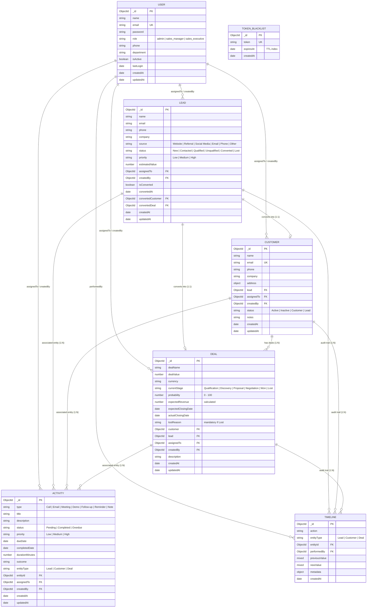

# CRM Sales Management System — Database Design & Schema Architecture

## 1. Overview
This document outlines the database design, schema relationships, indexing architecture, and data integrity guarantees implemented for the **CRM Sales Management System** using **MongoDB** and **Mongoose ODM**.

---

## 2. Entity-Relationship (ER) Architecture

---

## 3. Database Collections & Schema Specifications

### 3.1 `users` Collection
Stores user credentials, organizational roles, and active state flags.

| Field | Type | Required | Constraints / Default | Description |
| :--- | :--- | :--- | :--- | :--- |
| `_id` | `ObjectId` | Yes | Auto-generated PK | Unique identifier |
| `name` | `String` | Yes | Max 100 chars, trimmed | Full name of the user |
| `email` | `String` | Yes | Unique, lowercased, trimmed, Regex validated | Account login email |
| `password` | `String` | Yes | Min 6 chars, `select: false` | Bcrypt hashed password (10 salt rounds) |
| `role` | `String` | Yes | Enum: `['admin', 'sales_manager', 'sales_executive']` | Role for RBAC authorization |
| `phone` | `String` | No | Trimmed | Contact phone number |
| `department` | `String` | No | Default: `'Sales'` | Business department |
| `isActive` | `Boolean` | Yes | Default: `true` | Access activation toggle |
| `lastLogin` | `Date` | No | None | Timestamp of last successful authentication |
| `createdAt` | `Date` | Yes | Auto-managed via `timestamps: true` | Record creation date |
| `updatedAt` | `Date` | Yes | Auto-managed via `timestamps: true` | Record last modification date |

---

### 3.2 `leads` Collection
Captures prospective buyers across the marketing-to-sales funnel.

| Field | Type | Required | Constraints / Default | Description |
| :--- | :--- | :--- | :--- | :--- |
| `_id` | `ObjectId` | Yes | Auto-generated PK | Unique identifier |
| `name` | `String` | Yes | Trimmed, Max 100 chars | Lead name or contact person |
| `email` | `String` | No | Lowercased, Regex validated | Lead email address |
| `phone` | `String` | No | Trimmed | Lead phone number |
| `company` | `String` | No | Trimmed | Company organization |
| `source` | `String` | Yes | Enum: `Website`, `Referral`, `Social Media`, `Email`, `Phone`, `Other` | Acquisition channel |
| `status` | `String` | Yes | Enum: `New`, `Contacted`, `Qualified`, `Unqualified`, `Converted`, `Lost` | Qualification status |
| `priority` | `String` | Yes | Enum: `Low`, `Medium`, `High`, Default: `Medium` | Urgency priority level |
| `estimatedValue` | `Number` | No | Min 0, Default: 0 | Projected deal value |
| `assignedTo` | `ObjectId` | No | Ref: `User`, Indexed | Sales executive responsible |
| `createdBy` | `ObjectId` | Yes | Ref: `User`, Indexed | User who logged the lead |
| `isConverted` | `Boolean` | Yes | Default: `false`, Indexed | Conversion lock flag |
| `convertedAt` | `Date` | No | Set on conversion | Timestamp of conversion |
| `convertedCustomer` | `ObjectId` | No | Ref: `Customer` | Linked converted customer |
| `convertedDeal` | `ObjectId` | No | Ref: `Deal` | Linked converted deal |
| `createdAt` | `Date` | Yes | `timestamps: true` | Lead generation date |
| `updatedAt` | `Date` | Yes | `timestamps: true` | Last updated date |

---

### 3.3 `customers` Collection
Maintains converted enterprise accounts and historical client profiles.

| Field | Type | Required | Constraints / Default | Description |
| :--- | :--- | :--- | :--- | :--- |
| `_id` | `ObjectId` | Yes | Auto-generated PK | Unique identifier |
| `name` | `String` | Yes | Trimmed, Max 100 chars | Customer account name |
| `email` | `String` | Yes | Unique, Lowercased, Trimmed | Primary contact email |
| `phone` | `String` | No | Trimmed | Telephone number |
| `company` | `String` | No | Trimmed | Corporate entity |
| `address` | `Subdocument` | No | `street`, `city`, `state`, `postalCode`, `country` | Physical headquarters |
| `lead` | `ObjectId` | No | Ref: `Lead`, Indexed | Pointer to originating lead |
| `assignedTo` | `ObjectId` | Yes | Ref: `User`, Indexed | Account manager |
| `createdBy` | `ObjectId` | Yes | Ref: `User`, Indexed | Profile creator |
| `status` | `String` | Yes | Enum: `Active`, `Inactive`, `Customer`, `Lead`, Default: `Active` | Account health status |
| `notes` | `String` | No | Trimmed | Client notes |
| `createdAt` | `Date` | Yes | `timestamps: true` | Client onboarding date |
| `updatedAt` | `Date` | Yes | `timestamps: true` | Last profile update |

---

### 3.4 `deals` Collection
Tracks commercial negotiation pipelines through standard qualification gates.

| Field | Type | Required | Constraints / Default | Description |
| :--- | :--- | :--- | :--- | :--- |
| `_id` | `ObjectId` | Yes | Auto-generated PK | Unique identifier |
| `dealName` | `String` | Yes | Trimmed, Max 150 chars | Title of the opportunity |
| `dealValue` | `Number` | Yes | Min 1 (Must be > 0) | Total contract value |
| `currency` | `String` | No | Default: `'USD'`, Uppercase | Contract currency |
| `currentStage` | `String` | Yes | Enum: `Qualification`, `Discovery`, `Proposal`, `Negotiation`, `Won`, `Lost` | Pipeline stage |
| `probability` | `Number` | Yes | Range 0–100 | Win likelihood percentage |
| `expectedRevenue` | `Number` | Yes | Auto-computed: `Math.round(dealValue * (probability / 100))` | Expected revenue |
| `expectedClosingDate` | `Date` | Yes | Future date validation | Target close date |
| `actualClosingDate` | `Date` | No | Automatically set upon `Won` or `Lost` | Actual closure date |
| `lostReason` | `String` | No | Required if stage is `Lost` | Reason for loss |
| `customer` | `ObjectId` | No | Ref: `Customer`, Indexed | Associated client account |
| `lead` | `ObjectId` | No | Ref: `Lead`, Indexed | Associated originating lead |
| `assignedTo` | `ObjectId` | Yes | Ref: `User`, Indexed | Opportunity owner |
| `createdBy` | `ObjectId` | Yes | Ref: `User`, Indexed | Deal creator |
| `description` | `String` | No | Trimmed | Scope description |
| `createdAt` | `Date` | Yes | `timestamps: true` | Opportunity creation date |
| `updatedAt` | `Date` | Yes | `timestamps: true` | Last stage update |

---

### 3.5 `activities` Collection
Schedules and tracks interactions, meetings, and follow-ups.

| Field | Type | Required | Constraints / Default | Description |
| :--- | :--- | :--- | :--- | :--- |
| `_id` | `ObjectId` | Yes | Auto-generated PK | Unique identifier |
| `type` | `String` | Yes | Enum: `Call`, `Email`, `Meeting`, `Demo`, `Follow-up`, `Reminder`, `Note` | Activity classification |
| `title` | `String` | Yes | Trimmed, Max 200 chars | Brief title |
| `description` | `String` | No | Trimmed | Detailed notes or agenda |
| `status` | `String` | Yes | Enum: `Pending`, `Completed`, `Overdue`, Default: `Pending` | Execution status |
| `priority` | `String` | No | Enum: `Low`, `Medium`, `High`, Default: `Medium` | Priority |
| `dueDate` | `Date` | Yes | Default: `Date.now`, Indexed | Schedule deadline |
| `completedDate` | `Date` | No | Set when marked completed | Timestamp of completion |
| `durationMinutes` | `Number` | No | Min 1, Default: 15 | Estimated duration |
| `outcome` | `String` | No | Trimmed | Meeting or call notes |
| `entityType` | `String` | Yes | Enum: `Lead`, `Customer`, `Deal` | Polymorphic parent type |
| `entityId` | `ObjectId` | Yes | Polymorphic Ref to `entityType`, Indexed | Polymorphic parent ID |
| `assignedTo` | `ObjectId` | No | Ref: `User`, Indexed | Responsible rep |
| `createdBy` | `ObjectId` | Yes | Ref: `User`, Indexed | Logged by |
| `createdAt` | `Date` | Yes | `timestamps: true` | Log creation date |
| `updatedAt` | `Date` | Yes | `timestamps: true` | Update date |

---

### 3.6 `timelines` Collection
Immutable append-only audit trail capturing state changes across entities.

| Field | Type | Required | Constraints / Default | Description |
| :--- | :--- | :--- | :--- | :--- |
| `_id` | `ObjectId` | Yes | Auto-generated PK | Unique identifier |
| `action` | `String` | Yes | Enum: Standardized system actions | Action description |
| `entityType` | `String` | Yes | Enum: `Lead`, `Customer`, `Deal` | Target entity category |
| `entityId` | `ObjectId` | Yes | Ref: Dynamic | Target entity ID |
| `performedBy` | `ObjectId` | Yes | Ref: `User`, Indexed | Actor ID |
| `previousValue` | `Mixed` | No | Default: `null` | Previous state snapshot |
| `newValue` | `Mixed` | No | Default: `null` | Updated state snapshot |
| `metadata` | `Object` | No | Default: `{}` | Additional contextual payload |
| `createdAt` | `Date` | Yes | Auto-managed | Event timestamp |

---

## 4. Indexing Strategy & Performance Optimizations

| Collection | Index Keys | Type | Performance Justification |
| :--- | :--- | :--- | :--- |
| **`users`** | `{ email: 1 }` | Unique B-Tree | High-speed authentication lookup and duplicate prevention. |
| **`leads`** | `{ name: "text", company: "text", email: "text" }` | Text Index | High-speed full-text keyword search across multi-attribute queries. |
| **`leads`** | `{ status: 1, priority: 1, assignedTo: 1 }` | Compound B-Tree | Optimizes complex multi-filter dashboard and sales rep listings. |
| **`leads`** | `{ createdAt: -1 }` | Single-field | Fast sorting for recent leads. |
| **`customers`**| `{ email: 1 }` | Unique B-Tree | Prevents duplicate client registrations. |
| **`customers`**| `{ status: 1, assignedTo: 1 }` | Compound B-Tree | Filters active customer accounts by sales representative. |
| **`customers`**| `{ name: "text", company: "text", email: "text" }` | Text Index | Search across client names, emails, and company names. |
| **`deals`** | `{ currentStage: 1, assignedTo: 1 }` | Compound B-Tree | Essential for real-time pipeline funnel summaries and rep allocations. |
| **`deals`** | `{ expectedClosingDate: 1 }` | Single-field | Range queries for monthly and quarterly revenue forecasting. |
| **`deals`** | `{ dealValue: 1 }` | Single-field | Range filtering on deal values (`minAmount`, `maxAmount`). |
| **`activities`**| `{ entityType: 1, entityId: 1, status: 1 }` | Compound B-Tree | Instant retrieval of activities linked to specific leads, customers, or deals. |
| **`activities`**| `{ assignedTo: 1, dueDate: 1 }` | Compound B-Tree | Accelerates daily agenda queries and overdue detection checks. |
| **`timelines`** | `{ entityType: 1, entityId: 1, createdAt: -1 }` | Compound B-Tree | Instant chronological retrieval of audit trail for any CRM record. |
| **`tokenblacklists`** | `{ expiresAt: 1 }` | TTL Index (`expireAfterSeconds: 0`) | Automatic background deletion of revoked JWT tokens without cron jobs. |

---

## 5. Atomicity & Transactional Integrity
- **Lead-to-Customer & Deal Conversion**: Handled via MongoDB multi-document ACID transactions (`session.startTransaction()`) with an automated rollback handler. If transactions are run on a standalone MongoDB instance, a graceful compensating transaction handler automatically cleans up partially created documents to guarantee 100% data consistency.
- **Closed Deal Immutability**: Enforced via Mongoose pre-save hooks and service-level stage validation. Deals marked `Won` or `Lost` cannot be transitioned back to active stages.
- **Mandatory Lost Reason**: Dynamically enforced at both schema validation level and service layer when a deal is moved to `Lost`.
